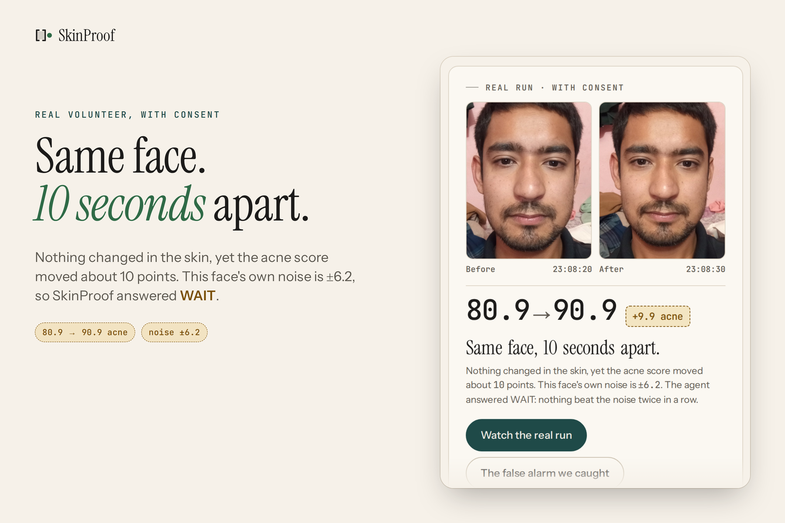
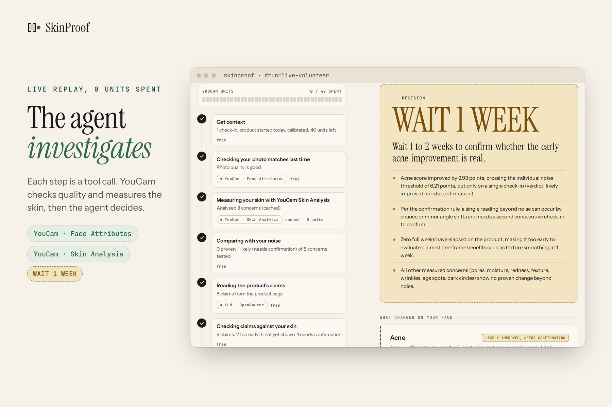
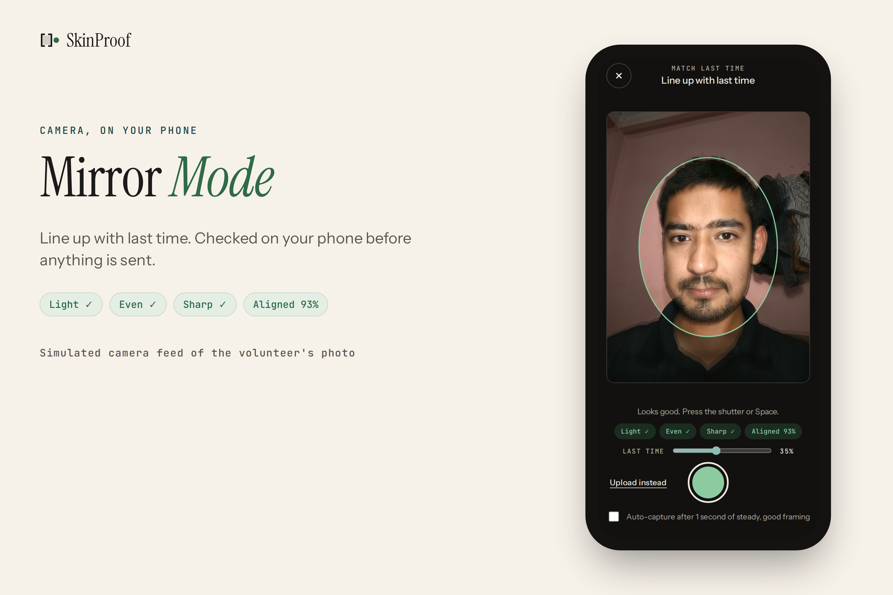
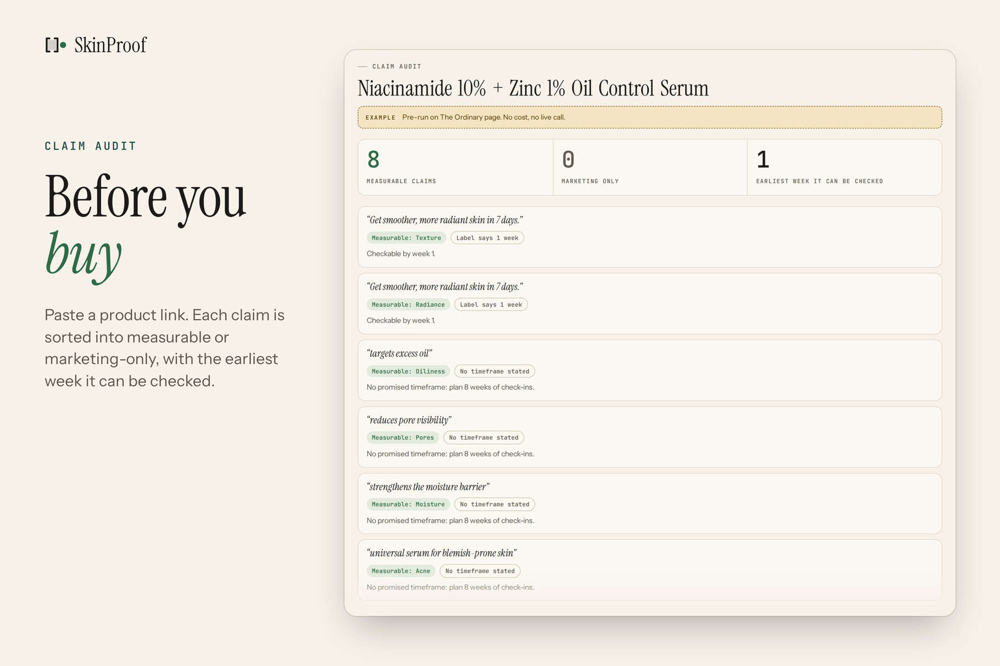
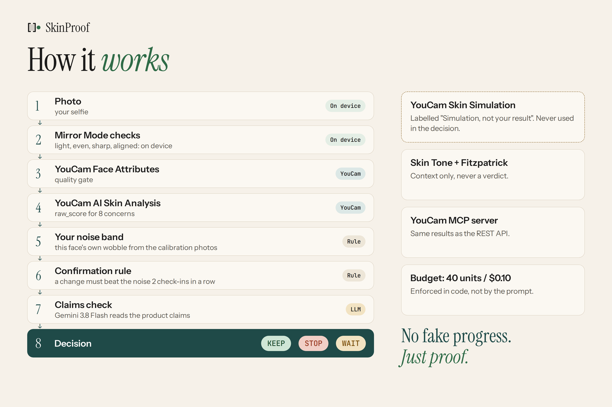
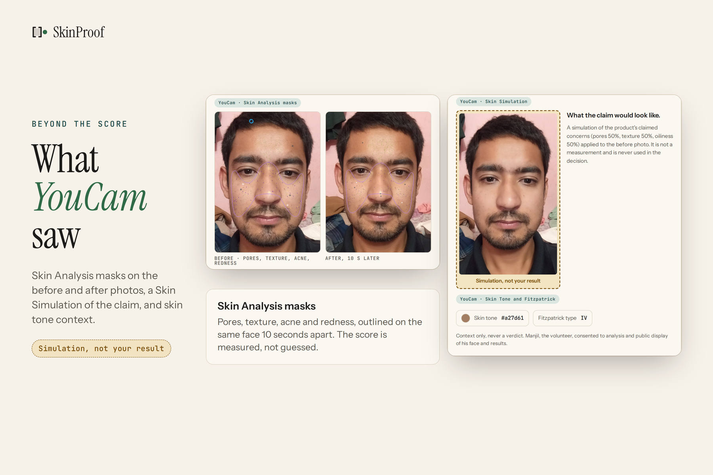

<div align="center">


# SkinProof

### Should I keep buying this?

An honest AI agent on YouCam Skin AI APIs: it learns how much skin scores vary on your own face, and only calls a
change real when it beats that noise twice in a row.

<p>
<a href="https://skinproof.aether-soft.tech"></a>
<a href="https://www.youtube.com/watch?v=465tb0S2l8E"></a>
<a href="https://skinproof.aether-soft.tech/buy"></a>
<a href="LICENSE"></a>
</p>
<p>
<a href="https://yce.perfectcorp.com/ai-api"></a>
<a href="https://yce.perfectcorp.com/ai-api"></a>
<a href="https://openrouter.ai/"></a>
<a href="https://www.python.org/"></a>
<a href="https://fastapi.tiangolo.com/"></a>
<a href="https://modelcontextprotocol.io/"></a>
<a href="https://opencv.org/"></a>
<a href="#run-it"></a>
</p>
<p>


</p>

<p>
<a href="docs/screens/home.png"></a>
<a href="docs/screens/agent.png"></a>
</p>

</div>

> [!TIP]
> **For judges**
>
> - **Video (2:23):** https://www.youtube.com/watch?v=465tb0S2l8E
> - **Live demo:** https://skinproof.aether-soft.tech
> - **The full journey in one click (8 weeks, invented data, ends KEEP):** https://skinproof.aether-soft.tech/#sample
> - **Three free replays, no keys, no spend:**
>   - the volunteer's real run, ending WAIT: https://skinproof.aether-soft.tech/#run=live-volunteer
>   - the false alarm we caught: https://skinproof.aether-soft.tech/#run=live-synthetic
>   - the sample run on invented data: "Try the sample" on the home page
> - **Before you buy:** https://skinproof.aether-soft.tech/buy, then "Try an example" (works without a key).
> - **Mirror Mode:** open the live demo on a phone and allow the camera. Nothing leaves the browser until you press
>   Measure.
> - **Daily live caps:** live agent runs and claim checks are capped per visitor and per day (see
>   [Privacy](#privacy)). When a cap is reached the site says so and the replays still work.
> - **Tests:** `uv sync && uv run pytest -q` (155 passing).

SkinProof makes YouCam's skin measurements trustworthy enough to act on. It learns the measurement noise on your
own face, helps you capture the same way every time, and only calls a change real when it beats that noise twice in
a row, so a score can drive a buy or stop decision.

It is built on Perfect Corp's YouCam APIs and MCP server. Every camera-based measurement varies with light, angle and
framing, in dermatology photography as much as in apps
([Nair and Santhanam, 2016](https://pubmed.ncbi.nlm.nih.gov/27398013/)). YouCam's own quality gates (face too small, face angle too large) already reject unusable photos up front. SkinProof
adds what a buy or stop decision needs on top: a per-person noise estimate, Mirror Mode capture alignment, and a
confirmation rule.

**Contents:** [What we measured](#what-we-measured-on-a-real-face) · [Why retailers win](#why-this-is-good-for-retailers-and-youcam) · [Features](#features) ·
[How it works](#how-it-works) · [YouCam APIs](#youcam-apis-used) · [The agent](#the-agent) ·
[Confirmation rule](#the-confirmation-rule) · [Product claims](#reading-the-products-claims) ·
[MCP](#mcp-in-both-directions) · [Honesty rules](#honesty-rules) · [Privacy](#privacy) ·
[Limitations](#honest-limitations) · [Run it](#run-it) · [Timeline](#built-during-the-hackathon)

---

## What we measured on a real face

A volunteer, with consent, took two selfies 10 seconds apart in the same room and light. His skin did not change.
YouCam's `raw_score` readings moved by normal capture variation (full table, cropped and uncropped, in
[bench/noise_RESULTS.md](bench/noise_RESULTS.md)):

| Concern      | Before | After | Change (points) |
|:-------------|-------:|------:|----------------:|
| Acne         |   95.9 |  86.5 |            -9.4 |
| Pores        |   51.9 |  45.9 |            -6.0 |
| Redness      |   98.0 |  95.4 |            -2.6 |
| Wrinkles     |   88.0 |  90.5 |            +2.5 |
| Age spots    |   93.1 |  94.3 |            +1.1 |
| Texture      |   88.5 |  88.2 |            -0.3 |
| Dark circles |   80.8 |  81.0 |            +0.1 |
| Moisture     |   53.9 |  53.9 |            -0.1 |

Across six same-evening frontal photos one pore reading was 35.9 against 58 to 64 for the rest, a 27.9-point range
from one odd capture. This is exactly why the noise has to be measured per person before a change is believed. The
live agent run on this face ends **WAIT, nothing proven** (`#run=live-volunteer`,
`demo/agent_trace_live_volunteer.json`).

We also tested YouCam Photo Lighting as a way to reduce that variation. It cut the median range by 22%, just under
our pre-registered 25% bar, so we left it off ([bench/lighting_RESULTS.md](bench/lighting_RESULTS.md)). Phone selfies
are auto-cropped to the face before YouCam (`src/skinproof/faceprep.py`) so they pass YouCam's face-size gate.

---

## Why this is good for retailers and YouCam

A tool that can say STOP sounds bad for sales. It is the opposite for anyone selling products that work:

- **Products that work get proof.** A brand that lists a claim and a timeframe can show how many opted-in customers
  actually beat their own noise ("Verified on real faces", shown in `/buy` as a labelled concept). That is a claim
  shoppers can trust, unlike "clinically proven" with no data.
- **Fewer returns and refund disputes.** A shopper who sees "WAIT 4 weeks, too early to tell" keeps using the product
  instead of returning it after 10 days of normal photo wobble.
- **Claims stay inside the evidence.** EU Regulation 655/2013 requires cosmetic claims to be supported; `/buy` shows
  which claims a photo can test and when.
- **YouCam's scores become decision-grade.** The same raw scores, read against each person's noise, turn a number that
  moves 9.9 points in 10 seconds into a result a retailer can stand behind. More trust means more scans.

---

## Features

- **Noise calibration.** 4 to 6 photos on one day give a per-concern threshold of `max(range, 2 x SD, 3 points)`.
  Only `raw_score` is used, because it is the right signal for measurement (`ui_score` is designed for display).
- **60-second quick noise check.** Four guided poses taken in Mirror Mode produce a first noise estimate in about a
  minute.
- **The agent.** An LLM tool-calling agent measures, compares with your noise, reads claims and ends with KEEP, STOP
  or WAIT N weeks (see [The agent](#the-agent)).
- **YouCam MCP in both directions**, a spend guard, and privacy controls (below).

### Mirror Mode

An in-browser camera, mobile friendly. A faint ghost overlay of your last photo lets you line up the same framing.
On-device checks for light, evenness, sharpness and alignment run live; nothing leaves the browser until you press
Measure. Capture metadata (alignment, brightness, evenness, sharpness, face ratio, whether the ghost was used,
whether checks passed) is stored with each photo.

<div align="center">

</div>

### Before you buy

At `/buy`, paste a product's claims, a URL or a label photo. You get:

- a claim audit: which claims a photo can measure and which are marketing only,
- the earliest week a change could be checked,
- a trial-duration reminder drawn from published trials,
- a prefill into the app.

"Try an example" works without a key. A retailer "Verified on real faces" badge is shown as a labelled concept only.

<div align="center">

</div>

---

## How it works

1. **Calibrate** with Mirror Mode (quick check or 4 to 6 photos; 5 to 6 with slight head turns is best).
2. **Tell it the product.** Name plus claims, as pasted text, a product URL, or a photo of the label.
3. **Check in** with a selfie. Mirror Mode shows the ghost of last time so framing and light match.
4. **Ask the agent.** It decides which YouCam tools to call, measures, compares each change with your noise, checks
   claims, and ends with KEEP, STOP or WAIT N weeks. The UI streams each step and its unit cost.

<div align="center">

</div>

---

## YouCam APIs used

Real unit costs charged by the API:

| API               | Endpoint                                   | Why                                                                                  |     Units |
|:------------------|:-------------------------------------------|:-------------------------------------------------------------------------------------|----------:|
| AI Skin Analysis  | `/s2s/v2.0/task/skin-analysis`             | The measurement. `raw_score` for 8 concerns, plus masks for the "What YouCam saw" panel. | 9 or 12 |
| Face Attributes   | `/s2s/v2.0/task/face-attr-analysis`        | Photo-quality gate: face found, frontal, light, framing. Recommends a retake before measuring. | 10 |
| Skin Tone         | `/s2s/v2.0/task/skin-tone-analysis`        | Context for redness and spot readings (volunteer: #a27d61). Never a verdict.         |        20 |
| Fitzpatrick       | `/s2s/v2.0/task/fitzpatrick-scale-analyzer` | Context for the advice (volunteer: IV). Never a verdict.                            |        10 |
| Skin Simulation   | `/s2s/v2.0/task/skin-simulation`           | Shows what a claimed improvement would look like. Always labelled "Simulation, not your result". | 4 |
| Photo Lighting    | `/s2s/v2.0/task/lighting`                  | Experiment: does normalising light before analysis reduce score variation? (`scripts/lighting_experiment.py`) | 2 |
| Text-to-Image V2  | `/s2s/v2.0/task/text-to-image/youcam`      | Generates a synthetic test face so no real person's photo was needed for early testing. | 1 |
| YouCam MCP server | `https://mcp-api-01.makeupar.com/mcp/beauty` | 50 beauty tools listed; Skin Analysis through MCP matches REST to within 0.001 (see [MCP](#mcp-in-both-directions)). | same as REST |

AI Skin Analysis costs 9 units for 1 to 4 concerns and 12 units for 5 to 8.

Units used so far: about 386 of the 1040 we started with (balance 654 at the last check). That covers calibration, the
real-face runs, the lighting experiment, the MCP check and live testing.

### What YouCam saw

A context panel for the volunteer run: Skin Analysis masks, a Skin Simulation (labelled "Simulation, not your
result"), Skin Tone (#a27d61) and Fitzpatrick IV. Context only, never a verdict.

<div align="center">

</div>

---

## The agent

- **Model:** Gemini 3.8 Flash on OpenRouter, driving a tool loop: `get_context`, `check_photo_consistency`,
  `analyze_skin`, `skin_context`, `compare_with_noise`, `read_product_claims`, `check_claims`,
  `simulate_claimed_result`, `finish`.
- **Budget enforced in code, not in the prompt:** 40 YouCam units and $0.10 of LLM spend per run, checked before every
  paid call, plus a 12-step cap. Repeated calls are cached and free.
- **Deterministic rule next to the model.** `decide()` in `src/skinproof/agent.py` computes KEEP, STOP or WAIT from the
  verdicts alone. If the model disagrees, both are shown and the model is not silently overridden. If the model never
  calls `finish`, the rule decides and the UI says so.
- **Guard rails.** It refuses to finish before measuring, and blocks measuring when the photo gate says retake.

---

## The confirmation rule

A change beyond noise on **one** check-in is only **Likely improved** or **Likely worse**, needs confirmation. It
becomes **Improved** or **Worse** (proven) only when the two most recent counted check-ins are both beyond the
threshold in the same direction versus the baseline. The baseline is the median of the first two check-ins when 4 or
more exist, otherwise the first.

The agent may say STOP or KEEP only on proven results. A likely result gives WAIT 2 weeks, "re-check to confirm",
naming the concern. Eight concerns are tested at once, so some will cross the line by chance; every verdict output
says how many were tested.

### The false alarm we caught

In our first live end-to-end run on an AI-generated face, the second photo was the same face turned **3 degrees**. The
skin had not changed, yet pores moved **4.6 points** against a 4.03 threshold calibrated from only 3 synthetic variants
(brightness and zoom, no rotation). The agent said STOP.

That was a false alarm, and it is our most honest finding: a 3 degree head turn moved a score by 4.6 points. We fixed
the method instead of hiding it:

- The original run is kept untouched in `demo/agent_trace_live_synthetic.json`.
- Under today's rules the same inputs give **WAIT 2 weeks (likely worse, re-check)** (rule R2b).
- The app replays that run with a banner explaining it ("The false alarm we caught" on the sample screen, or
  `#run=live-synthetic`).
- Calibration now requires 4 or more photos. With fewer than 6 the observed range underestimates noise, so 5 to 6 with
  head turns is recommended.
- The synthetic perturbations include rotation of plus and minus 3 degrees and a small yaw-like crop shift.

---

## Reading the product's claims

`extract_claims` takes pasted text, a URL or a label photo and returns measurable claims (concern, quote, timeframe).
`compare` is deterministic and gives each claim a status:

| Status               | Meaning                                                        |
|:---------------------|:---------------------------------------------------------------|
| `SUPPORTED`          | Proven improvement                                             |
| `CONTRADICTED`       | Proven worsening                                               |
| `NEEDS_CONFIRMATION` | One check-in beyond noise (likely)                             |
| `NOT_YET_SHOWN`      | No proven change past the claimed time                         |
| `TOO_EARLY`          | The claimed timeframe has not passed                           |
| `NOT_MEASURABLE`     | A photo cannot measure it (scent, "dermatologist tested")      |

---

## MCP in both directions

### 1. SkinProof calls YouCam's official MCP server

Perfect Corp runs MCP servers at `https://mcp-api-01.makeupar.com/mcp/beauty`, also `/fashion` and `/creators`.
`youcam_mcp.py` is a small JSON-RPC client (initialize, tools/list, tools/call) and `bench/youcam_mcp_tools.json` is
the live tool list (50 beauty tools). Set `SKINPROOF_YOUCAM_TRANSPORT=mcp` (default `rest`) and the agent's
`analyze_skin` runs through `upload_file` then `AI-Skin-Analysis`. Proof on our AI-generated synthetic face: 12 units,
and every raw score matched the REST result to within 0.001 points (`bench/youcam_mcp_vs_rest.json`).

### 2. SkinProof is itself an MCP server

It runs over stdio, so Claude Desktop or Cursor can ask it questions:

```json
{ "mcpServers": { "skinproof": {
    "command": "uv",
    "args": ["--directory", "/path/to/skinproof", "run", "skinproof", "mcp"],
    "env": { "SKINPROOF_MCP_ALLOW_LLM": "0" } } } }
```

| Tool                                                      | What it does                                                                       |
|:----------------------------------------------------------|:-----------------------------------------------------------------------------------|
| `skinproof_explain_noise(profile_id)`                     | Explains the stored noise estimate.                                                |
| `skinproof_should_i_keep_buying(profile_id, product_id)`  | Deterministic rule on stored data, no YouCam units, no LLM.                        |
| `skinproof_demo_runs()`                                   | Lists the recorded demo runs.                                                      |
| `skinproof_read_claims(text\|url)`                        | Costs about a cent of OpenRouter; stays off until `SKINPROOF_MCP_ALLOW_LLM=1`.     |

It is stdio only and reads your local `private/` store; nothing that can spend money is mounted on the public web
server.

---

## Honesty rules

- No overall score, ever. One question: KEEP, STOP or WAIT.
- `raw_score` only; simulations are illustrations of a claim, never evidence.
- A single beyond-noise reading is "likely"; "proven" needs two in a row, same direction.
- Every verdict says how many concerns were tested.
- Context panels (tone, Fitzpatrick, masks) never change a verdict.

---

## Privacy

- User face photos are stored on the server under `private/`, which is gitignored and never committed.
  The one exception is `demo/volunteer/`: the volunteer's two check-in photos, their masks and the simulation image are
  published with his explicit consent, so judges can see exactly what YouCam measured.
- The app tells you photos go to YouCam (Perfect Corp) for analysis, and a "Delete my data" button
  (`DELETE /api/profiles/{id}`) removes a profile and its files.
- Mirror Mode checks run on your device; nothing is uploaded until you press Measure.
- Tests and the sample run use invented scores or an AI-generated face. The volunteer consented to analysis and to the
  public display of his photos, scores, the demo video and the screenshots in this README.
- API keys live only on the server (`.env`, gitignored).
- A **spend guard** caps daily YouCam units (120 shared, 72 per IP), LLM dollars ($1 per day), agent runs (3 per IP)
  and claim checks (10 per IP), so a public demo cannot drain the keys. When a cap is reached the site says so and the
  replays still work.

---

## Honest limitations

- One volunteer, one evening. The noise numbers show that capture variation is large enough to matter, not a
  population estimate. No longitudinal study yet.
- Mirror Mode thresholds (light, evenness, sharpness, alignment) were tuned on a synthetic feed, not yet validated on
  many real phones.
- A photo score is a proxy, not a dermatological measurement. Not a medical device.
- Calibration from a handful of photos is still an estimate. Proven means "beyond your noise twice in a row", not
  "caused by the product".
- Many concerns are tested together, so false positives remain possible; confirmation reduces them but does not
  remove them.
- The sample demo uses invented data and is labelled so. The retailer badge is a concept, not a product.

---

## Run it

```bash
uv sync
cp .env.example .env   # then add your YouCam and OpenRouter keys (never committed)
uv run skinproof serve --port 8100
uv run pytest -q       # 155 passing
```

Without keys, "Try the sample" replays a recorded run on invented data, and `/buy` has "Try an example".

- Offline scripts: `scripts/make_demo_trace.py`, `scripts/reevaluate_recorded_run.py`.
- `scripts/e2e_live.py` and `scripts/synthetic_noise.py` spend units and need an explicit flag.
- Impact case and sources: [docs/IMPACT.md](docs/IMPACT.md). Devpost text: [docs/DEVPOST.md](docs/DEVPOST.md).

---

## Built during the hackathon

Local time, UTC+5:45, from `git log`:

| Date, time (local)        | Commit                                                                                   |
|:--------------------------|:-----------------------------------------------------------------------------------------|
| 2026-11-01 19:06          | SkinProof core: YouCam client, noise calibration, verdicts, store, web UI, tests         |
| 2026-11-01 22:07 to 22:16 | Agent plan, OpenRouter claims, tool-calling agent with budget, extra YouCam endpoints, photo consistency |
| 2026-11-01 22:30          | Confirmation rule, 4-photo calibration, agent photo upload                               |
| 2026-11-01 23:24 to 23:31 | Lighting experiment (22%), face auto-crop, volunteer live run and noise findings         |
| 2026-11-01 23:43          | Daily spend guard, per-profile isolation, profile delete                                 |
| 2026-11-01 23:53          | MCP both ways (YouCam MCP client, SkinProof MCP server)                                  |
| 2026-11-01 23:54          | Impact case and Devpost text                                                             |
| 2026-11-01 23:58          | UI redesign (lab-notebook look)                                                          |
| 2026-11-02 00:06          | UI polish                                                                                |
| 2026-11-02 00:12          | Before you buy (`/buy`, claim audit)                                                     |
| 2026-11-02 00:23          | "What YouCam saw" panel                                                                  |
| 2026-11-02 00:27          | Mirror Mode, 60-second noise check, `/buy` prefill, capture metadata                     |
| 2026-11-02 00:30          | Docs: reframed as making YouCam measurements actionable; MCP, spend guard, judge testing steps |
| 2026-11-02 01:30 to 01:38 | Devpost text with absolute links and consent wording; demo video link                    |
| 2026-11-02 01:57          | README restyle: header, judges block, screenshots                                        |

---

Released under the [MIT License](LICENSE).
